# ABZA Shader

A shader pack made for the **ABZA** modpack (Minecraft 1.20.1, Forge), built on [Sundial Lite](https://www.curseforge.com/minecraft/shaders/sundial-lite) by GeForceLegend. Inspired by Complementary and Photon.

The pack is dedicated to the ABZA modpack. It runs in other 1.20.1 Forge setups with Oculus, but the planets and their skies come from the modpack; see "Outside the modpack" below.

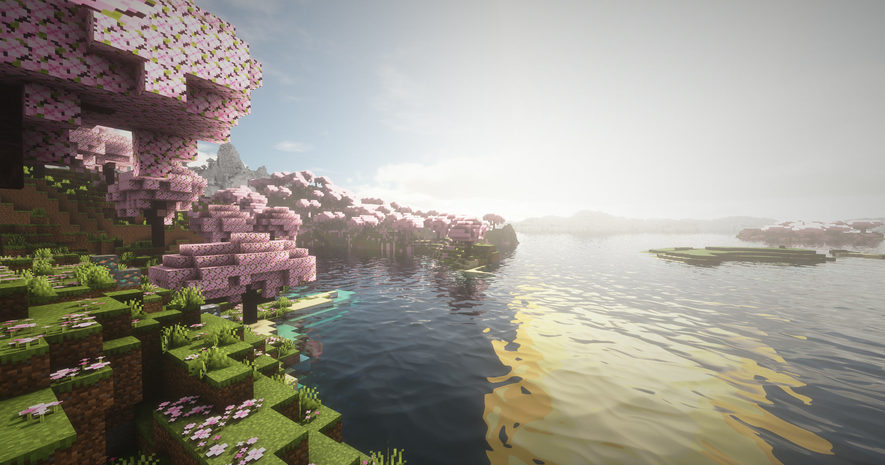

***

## Requirements

<table>
<tr><th align="left">Requirement</th><th align="left">Version</th></tr>
<tr><td><strong>Forge</strong></td><td>47</td></tr>
<tr><td><strong>Oculus</strong></td><td>1.8.0, with Embeddium</td></tr>
<tr><td><strong>Distant Horizons</strong></td><td><strong>Optional</strong>, tested with 3.3.2</td></tr>
<tr><td><strong><a href="https://github.com/RinkyDinkyNooble/shaders-companion">Shaders Companion</a></strong></td><td><strong>Optional</strong>, 0.6.5: mirrors in water and glass</td></tr>
</table>

***

## Mirrors With Shaders Companion

With the [Shaders Companion](https://github.com/RinkyDinkyNooble/shaders-companion) mod installed, water and stained or tinted glass work as <strong>mirrors</strong>: they show yourself, the mobs, chests and buildings behind you and Distant Horizons' far terrain, with the same light and shadows as the rest of the world. Without the mod nothing changes: reflections show what is on screen.

<table>
<tr>
<td align="center"><a href="https://raw.githubusercontent.com/RinkyDinkyNooble/abza-shader-pack/main/curseforge/images/reflection-entities.jpg" rel="nofollow">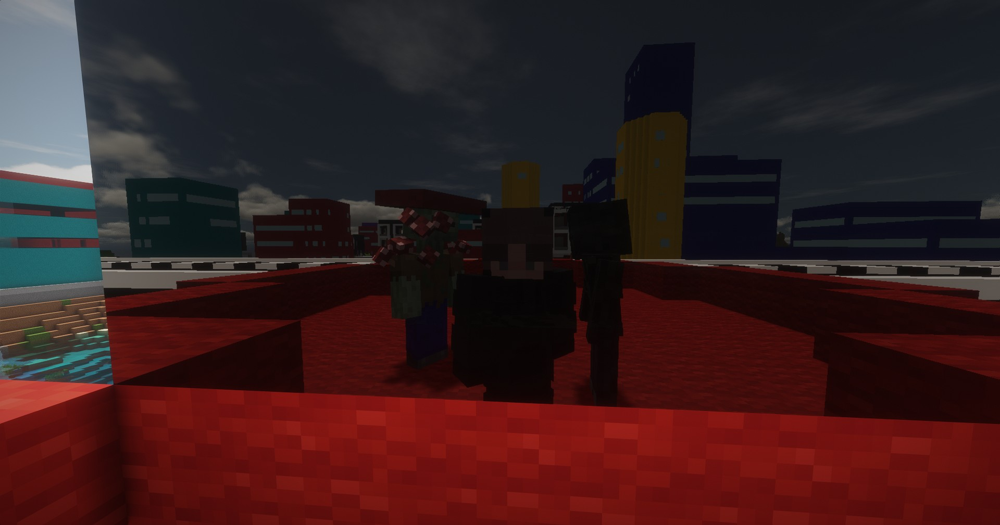</a></td>
<td align="center"><a href="https://raw.githubusercontent.com/RinkyDinkyNooble/abza-shader-pack/main/curseforge/images/reflection-distant-horizons.jpg" rel="nofollow">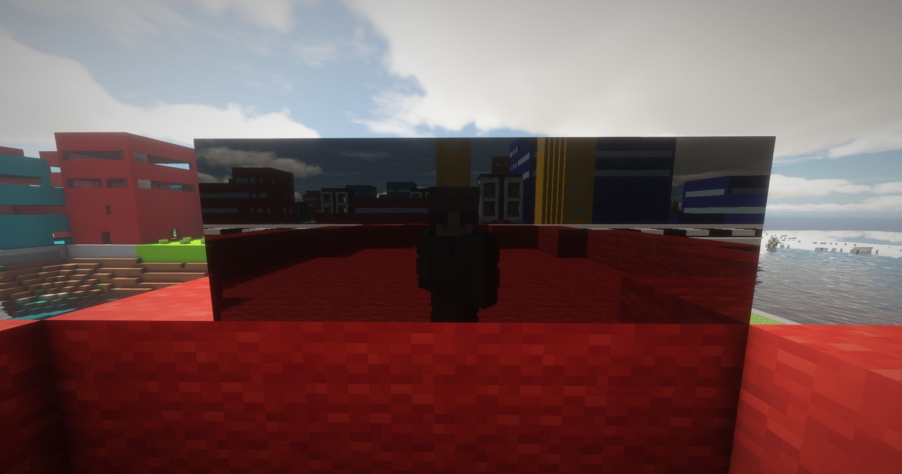</a></td>
</tr>
<tr>
<td align="center"><strong>Mobs And Players</strong> You and the mobs beside you in glass</td>
<td align="center"><strong>Distant Horizons</strong> The city behind you, far terrain included</td>
</tr>
<tr>
<td align="center"><a href="https://raw.githubusercontent.com/RinkyDinkyNooble/abza-shader-pack/main/curseforge/images/reflection-gun-armour.jpg" rel="nofollow">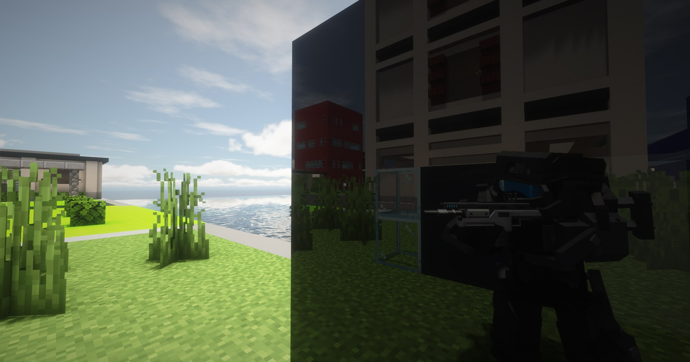</a></td>
<td align="center"><a href="https://raw.githubusercontent.com/RinkyDinkyNooble/abza-shader-pack/main/curseforge/images/reflection-town.jpg" rel="nofollow">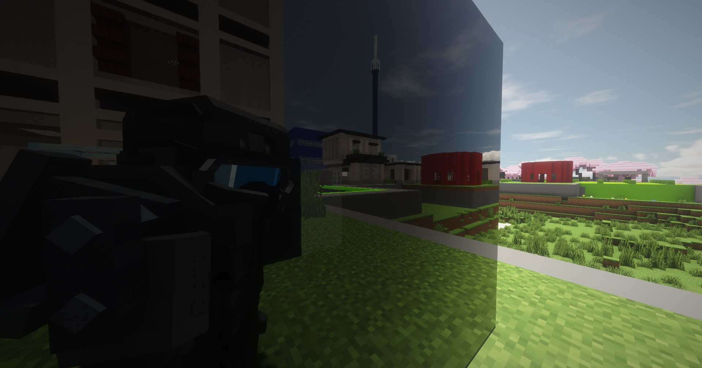</a></td>
</tr>
<tr>
<td align="center"><strong>Gun And Armour</strong> What you hold and wear, in black glass</td>
<td align="center"><strong>Many Features Combined</strong> You, the town and the sky in one glass wall</td>
</tr>
</table>

***

## Presets

"Profile" on the main shader screen sets every performance option at once. "ABZA modpack", on the same screen, makes water on Earth reflect the modpack's large square sun: Standard turns it off, ABZA on, and the other presets leave it as it is.

<table>
<tr><th align="left">Preset</th><th align="left">What it sets</th></tr>
<tr><td><strong>Potato</strong></td><td>Every costly effect off or at its lowest; a 256-pixel shadow map out to 16 blocks, no mob shadows</td></tr>
<tr><td><strong>Standard</strong> (<strong>default</strong>)</td><td>The balanced preset the pack is tuned at: 1024-pixel shadows out to 80 blocks, reflections, clouds, light shafts, ambient occlusion</td></tr>
<tr><td><strong>ABZA</strong></td><td>Standard with "ABZA modpack" on</td></tr>
<tr><td><strong>High</strong></td><td>Standard with 2048-pixel shadows, sharper ground textures, depth of field and underwater caustics</td></tr>
<tr><td><strong>Ultra</strong></td><td>Standard with 4096-pixel shadows, coloured shadows from glass, cloud shadows, underwater caustics, depth of field, reflections on every surface that isn't fully rough, and sharper ground textures</td></tr>
<tr><td><strong>Max</strong></td><td>Ultra with ray-traced bounce light (4 rays per pixel)</td></tr>
</table>

***

## Gallery

<table>
<tr>
<td align="center"><a href="https://raw.githubusercontent.com/RinkyDinkyNooble/abza-shader-pack/main/curseforge/images/interior-furniture.jpg" rel="nofollow">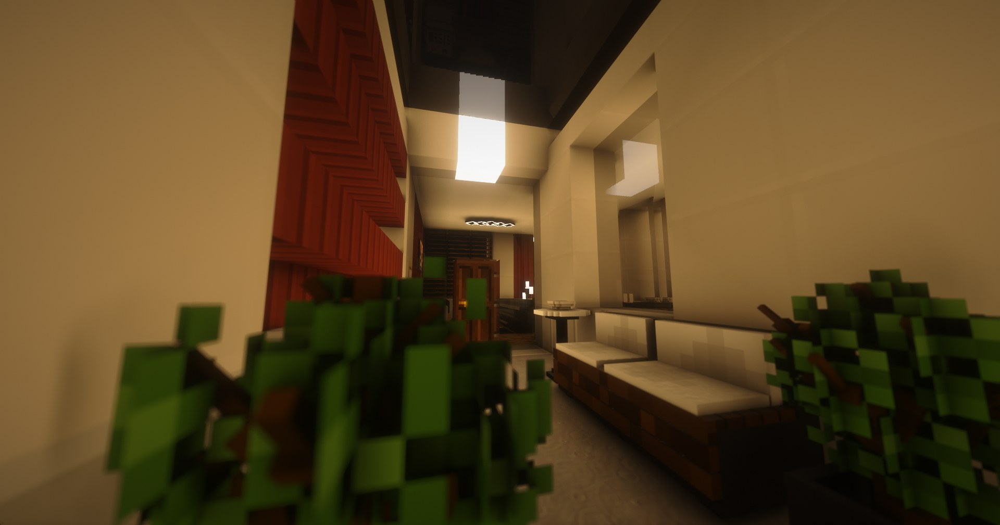</a></td>
<td align="center"><a href="https://raw.githubusercontent.com/RinkyDinkyNooble/abza-shader-pack/main/curseforge/images/rain-night-house.jpg" rel="nofollow">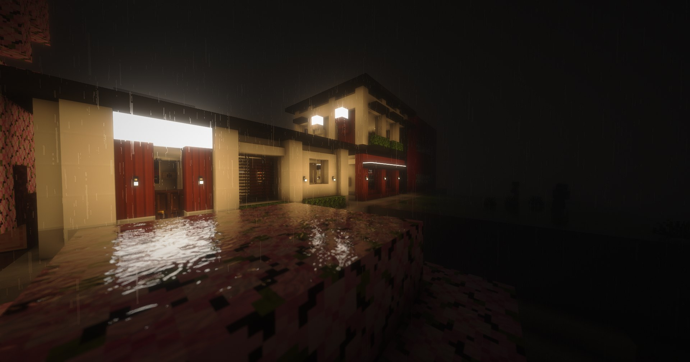</a></td>
</tr>
<tr>
<td align="center">A hallway with furniture and plants</td>
<td align="center">A lit house in the rain at night</td>
</tr>
<tr>
<td align="center"><a href="https://raw.githubusercontent.com/RinkyDinkyNooble/abza-shader-pack/main/curseforge/images/earth-dusk-ores.jpg" rel="nofollow">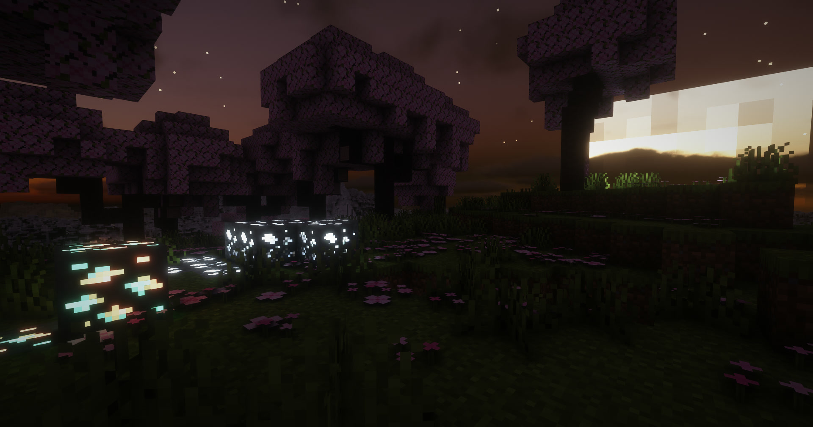</a></td>
<td align="center"><a href="https://raw.githubusercontent.com/RinkyDinkyNooble/abza-shader-pack/main/curseforge/images/earth-night-sky.jpg" rel="nofollow">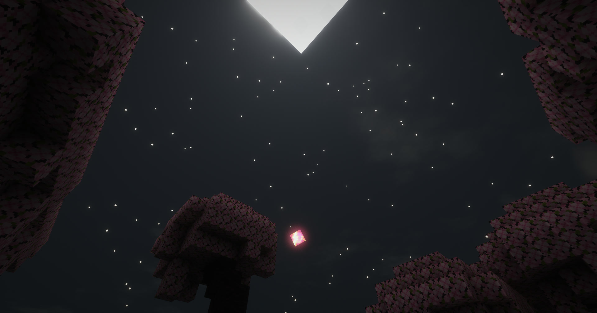</a></td>
</tr>
<tr>
<td align="center">Earth at dusk: glowing ores</td>
<td align="center">Earth's night sky in the modpack</td>
</tr>
<tr>
<td align="center"><a href="https://raw.githubusercontent.com/RinkyDinkyNooble/abza-shader-pack/main/curseforge/images/earth-rain.jpg" rel="nofollow">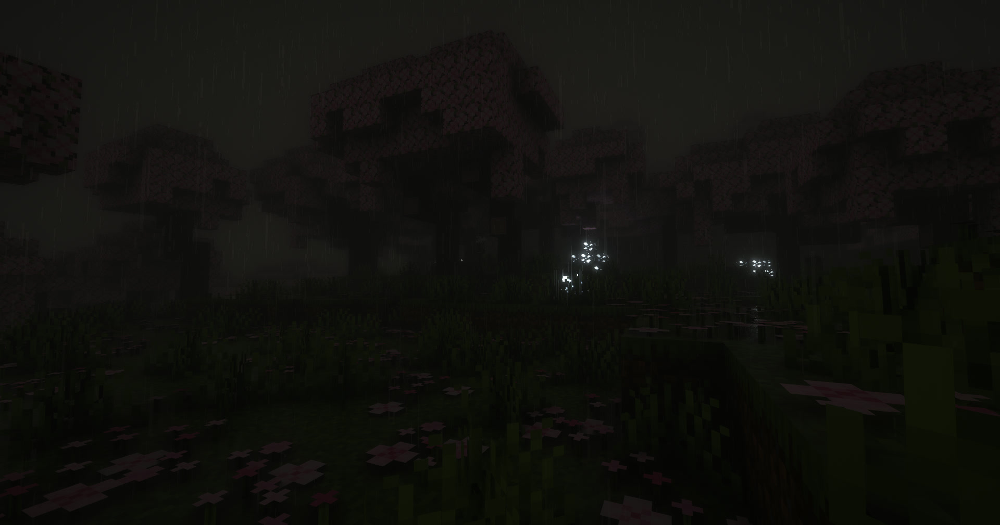</a></td>
<td align="center"><a href="https://raw.githubusercontent.com/RinkyDinkyNooble/abza-shader-pack/main/curseforge/images/cinder.jpg" rel="nofollow">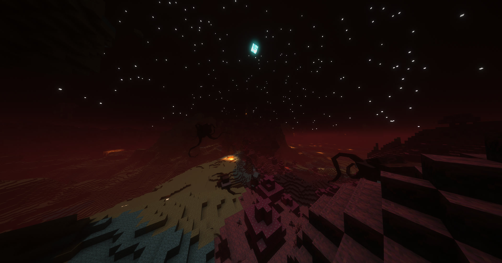</a></td>
</tr>
<tr>
<td align="center">Rain at night</td>
<td align="center">Cinder: ash haze and lava glow under Eden</td>
</tr>
<tr>
<td align="center"><a href="https://raw.githubusercontent.com/RinkyDinkyNooble/abza-shader-pack/main/curseforge/images/moon.gif" rel="nofollow">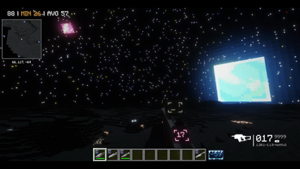</a></td>
<td align="center"><a href="https://raw.githubusercontent.com/RinkyDinkyNooble/abza-shader-pack/main/curseforge/images/cinder-eye-lands.gif" rel="nofollow">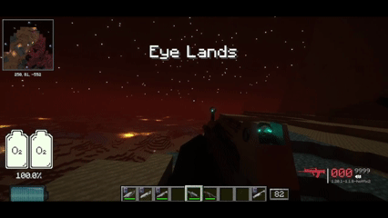</a></td>
</tr>
<tr>
<td align="center">The Moon, with Earth overhead</td>
<td align="center">Cinder's Eye Lands</td>
</tr>
<tr>
<td align="center"><a href="https://raw.githubusercontent.com/RinkyDinkyNooble/abza-shader-pack/main/curseforge/images/distant-horizons.gif" rel="nofollow">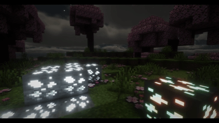</a></td>
<td align="center"><a href="https://raw.githubusercontent.com/RinkyDinkyNooble/abza-shader-pack/main/curseforge/images/optics.gif" rel="nofollow">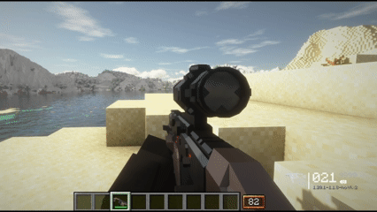</a></td>
</tr>
<tr>
<td align="center">Distant Horizons terrain at night</td>
<td align="center">Aiming a TaCZ optic</td>
</tr>
</table>

***

## What It Adds To Sundial Lite

*   **Ad Astra's sky:** the sun, moon and planets Ad Astra draws are the visible ones, and the shader's light, shadows and light shafts come from that same sun. Water reflects the sun's square shape. Ad Astra's coloured stars keep their colours, and on airless worlds they stay visible by day.
*   **Planet fog** in each biome's own fog colour, from the ground to the horizon, Distant Horizons terrain included.
*   **Exposure modes** (Post processing > Exposure): Steady (the default) follows the time of day, the weather and the world, never where you look; Metered follows the brightness on screen; Off keeps one exposure per world. Dark worlds stay dark in every mode.
*   **Glowing ores,** vanilla and modded: only the ore-coloured pixels glow.
*   **Shading where blocks meet:** crease shading on top of screen-space ambient occlusion, and vanilla's block corner shading. Ambient occlusion and ray-traced bounce light each have a switch (Lighting > Ray tracing).
*   **Sunshine sheen:** a soft sunlit highlight on ground and grass, plants that glow when lit from behind, and darker shade.
*   **Speed:** clouds and light shafts are computed at half resolution and smoothed over frames, reflections reuse the clouds already on screen, and Umbra skips its shadow pass. Costly settings go much lower than in Sundial, with separate switches for entity, player and block-entity shadows.
*   **Mod fixes:** no ghost rings when aiming TaCZ optics, no mirror glare on held glass, and Distant Horizons blocks glow by their light level.

***

## Outside the modpack

*   The large square sun, the moon and the planets in Earth's sky come from the modpack's Ad Astra sky files, not from the shader. Without them, Earth shows Minecraft's usual sun and moon, and the shader lights the world from those. Keep "ABZA modpack" off there, so water reflects Minecraft's sun at its own size.
*   Interloper, Cinder, Eden, Umbra and their orbits exist only in the modpack. The Moon and the Earth and Moon orbits come with Ad Astra.
*   Dimensions from other mods use the pack's base settings: Sundial's look with ABZA's shared changes. The Nether and the End use Sundial's own.
*   Glowing ores cover the modpack's ore mods; ores from other mods render normally.

***

## Known Issues

*   Taking a TaCZ gun for the first time can show long dark spikes under the terrain. Reloading shaders (F3+R) fixes it; stock Sundial does it too.
*   Zombie Awareness's blood marks aren't drawn with shaders on.

***

## Credit

**Sundial Lite** is made by GeForceLegend and released under the GNU General Public License v3.0 ([GitHub](https://github.com/GeForceLegend/Sundial-Lite), [Modrinth](https://modrinth.com/shader/sundial-lite), [CurseForge](https://www.curseforge.com/minecraft/shaders/sundial-lite)). ABZA Shader is an independent fork, not affiliated with or endorsed by GeForceLegend, released under the same licence. The source is on [GitHub](https://github.com/RinkyDinkyNooble/abza-shader-pack).
