# ABZA Shader

A shader pack made for the **ABZA** modpack (Minecraft 1.20.1, Forge), built on [Sundial Lite](https://www.curseforge.com/minecraft/shaders/sundial-lite) by GeForceLegend. Inspired by Complementary and Photon.

The pack is dedicated to the ABZA modpack. It runs in other 1.20.1 Forge setups with Oculus, but the planets and their skies come from the modpack; see "Outside the modpack" below.

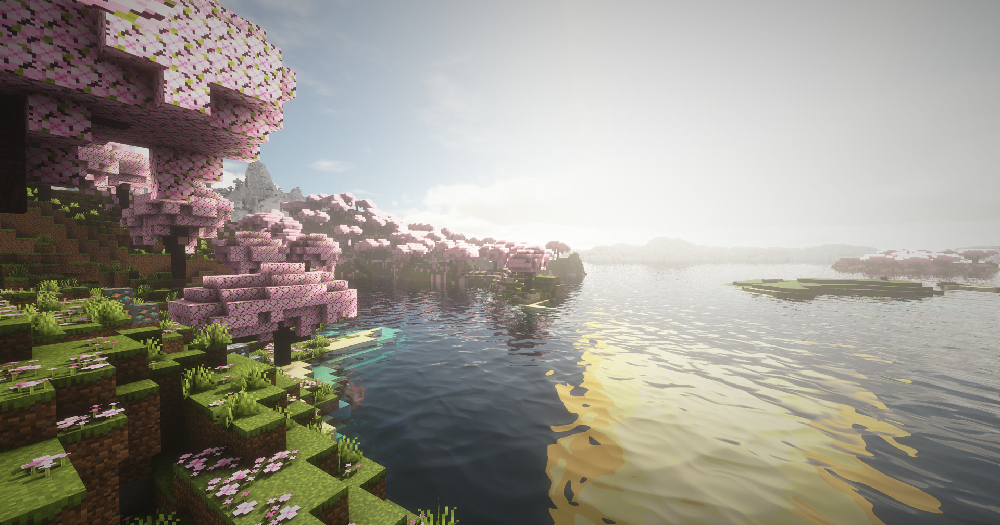

***

## Gallery

<table>
<tr>
<td align="center"><a href="https://raw.githubusercontent.com/RinkyDinkyNooble/abza-shader-pack/main/curseforge/images/neon-rooftop-rain.jpg" rel="nofollow">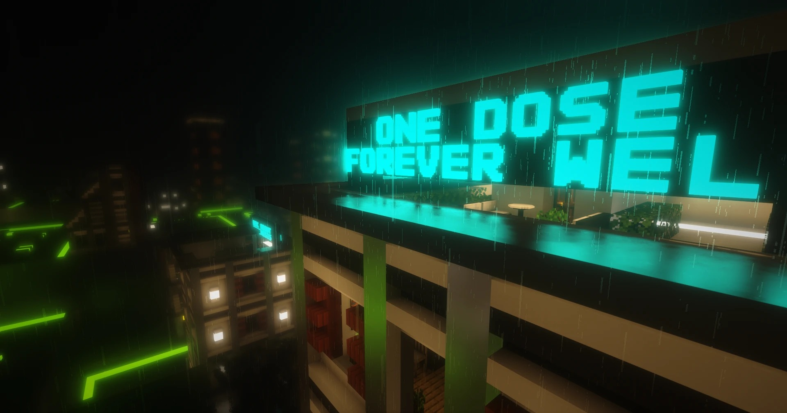</a></td>
<td align="center"><a href="https://raw.githubusercontent.com/RinkyDinkyNooble/abza-shader-pack/main/curseforge/images/shopfront-rain.jpg" rel="nofollow">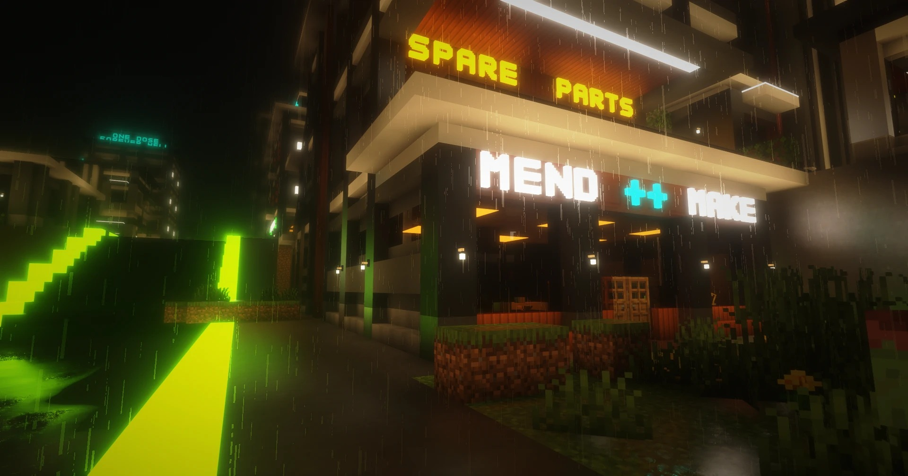</a></td>
</tr>
<tr>
<td align="center"><strong>Neon In The Rain</strong> A rooftop sign and the wet roof below it</td>
<td align="center"><strong>Shopfront</strong> Glowing signs on a rainy night</td>
</tr>
<tr>
<td align="center"><a href="https://raw.githubusercontent.com/RinkyDinkyNooble/abza-shader-pack/main/curseforge/images/neon-street-rain.jpg" rel="nofollow">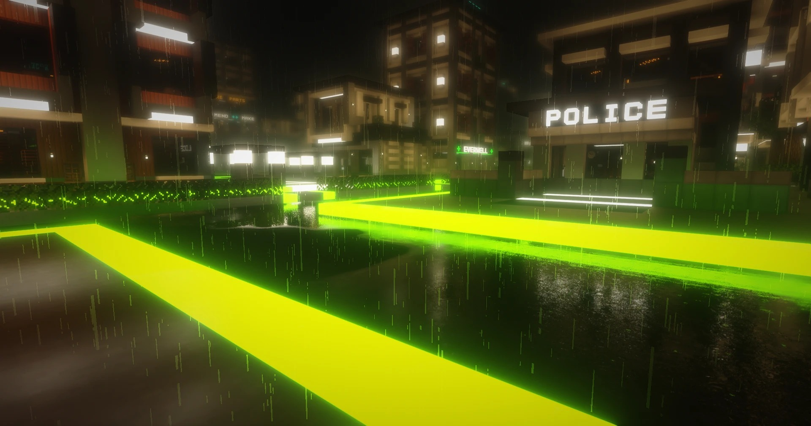</a></td>
<td align="center"><a href="https://raw.githubusercontent.com/RinkyDinkyNooble/abza-shader-pack/main/curseforge/images/helicopter-street.jpg" rel="nofollow">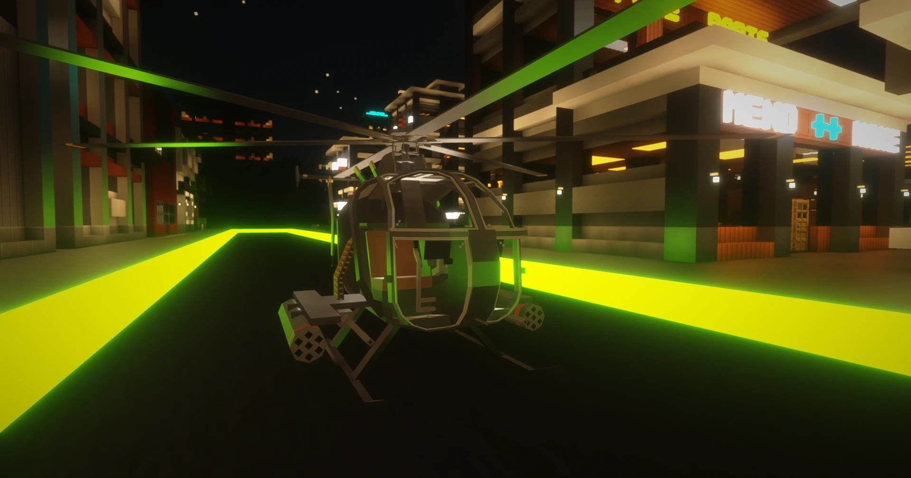</a></td>
</tr>
<tr>
<td align="center"><strong>Wet Streets</strong> Neon lines in the puddles</td>
<td align="center"><strong>Helicopter</strong> A street lit by neon lines</td>
</tr>
<tr>
<td align="center"><a href="https://raw.githubusercontent.com/RinkyDinkyNooble/abza-shader-pack/main/curseforge/images/ship-rain.jpg" rel="nofollow">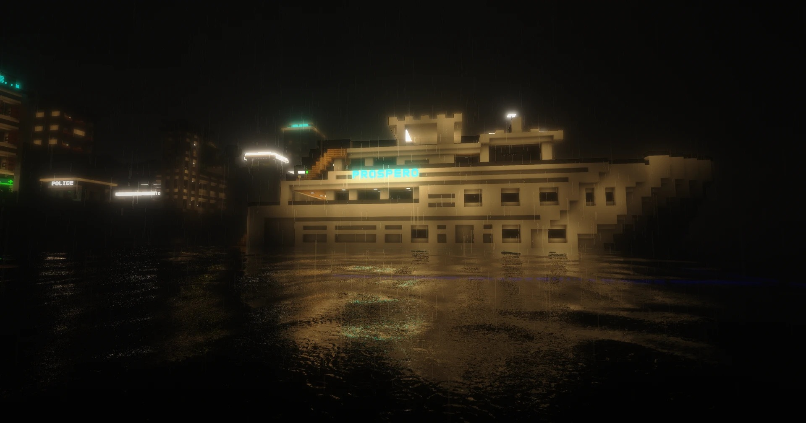</a></td>
<td align="center"><a href="https://raw.githubusercontent.com/RinkyDinkyNooble/abza-shader-pack/main/curseforge/images/diner.jpg" rel="nofollow">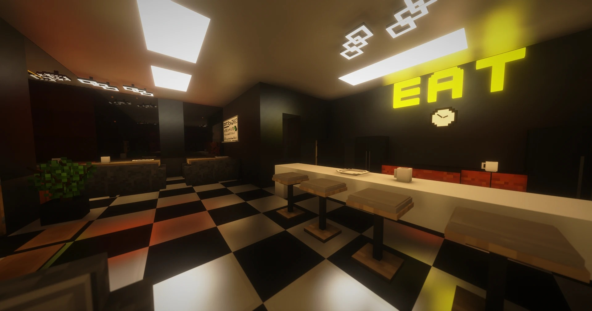</a></td>
</tr>
<tr>
<td align="center"><strong>Ship At Night</strong> Its lights on the water in the rain</td>
<td align="center"><strong>Diner</strong> Ceiling lights and a glowing sign</td>
</tr>
<tr>
<td align="center"><a href="https://raw.githubusercontent.com/RinkyDinkyNooble/abza-shader-pack/main/curseforge/images/glowing-ores.jpg" rel="nofollow">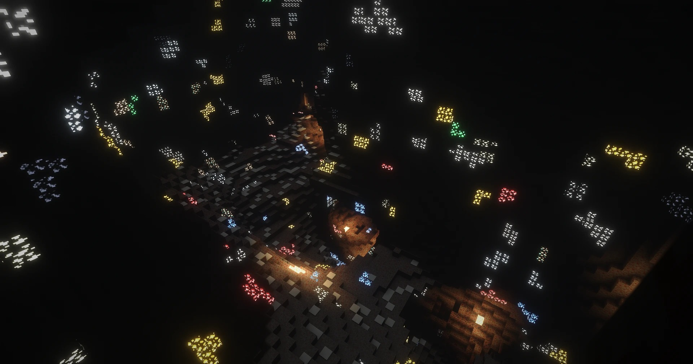</a></td>
<td align="center"><a href="https://raw.githubusercontent.com/RinkyDinkyNooble/abza-shader-pack/main/curseforge/images/glowing-mobs-rain.jpg" rel="nofollow">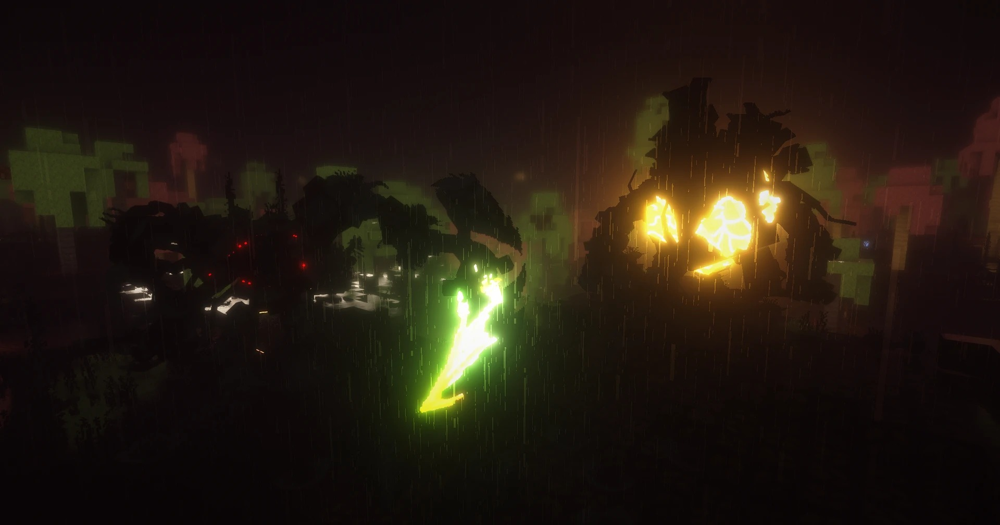</a></td>
</tr>
<tr>
<td align="center"><strong>Glowing Ores</strong> Vanilla and modded ores in the dark</td>
<td align="center"><strong>Glowing Creatures</strong> A rainy forest at night</td>
</tr>
<tr>
<td align="center"><a href="https://raw.githubusercontent.com/RinkyDinkyNooble/abza-shader-pack/main/curseforge/images/fog-pastel-woods.jpg" rel="nofollow">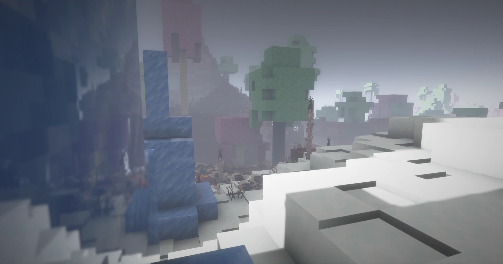</a></td>
<td align="center"><a href="https://raw.githubusercontent.com/RinkyDinkyNooble/abza-shader-pack/main/curseforge/images/astronaut-day-stars.jpg" rel="nofollow">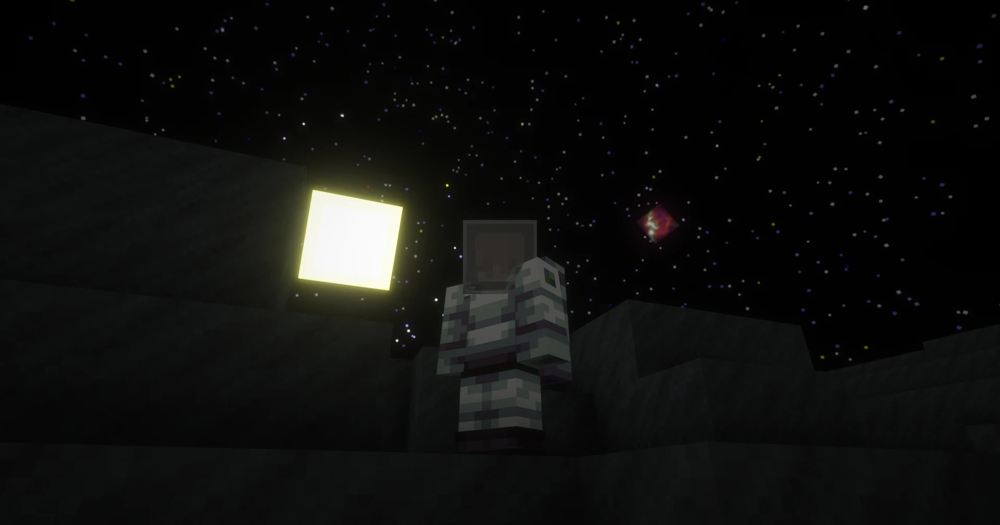</a></td>
</tr>
<tr>
<td align="center"><strong>Fog</strong> Pastel woods in the fog</td>
<td align="center"><strong>Airless World</strong> Stars by day under a square sun</td>
</tr>
<tr>
<td align="center"><a href="https://raw.githubusercontent.com/RinkyDinkyNooble/abza-shader-pack/main/curseforge/images/moon.gif" rel="nofollow">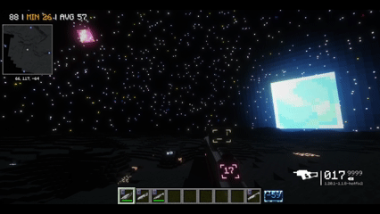</a></td>
<td align="center"><a href="https://raw.githubusercontent.com/RinkyDinkyNooble/abza-shader-pack/main/curseforge/images/cinder-eye-lands.gif" rel="nofollow">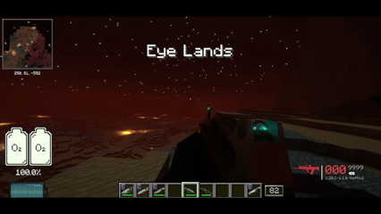</a></td>
</tr>
<tr>
<td align="center"><strong>The Moon</strong> With Earth overhead</td>
<td align="center"><strong>Cinder</strong> The Eye Lands</td>
</tr>
<tr>
<td align="center"><a href="https://raw.githubusercontent.com/RinkyDinkyNooble/abza-shader-pack/main/curseforge/images/distant-horizons.gif" rel="nofollow">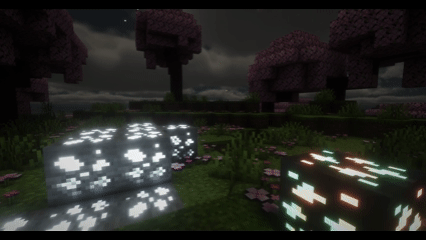</a></td>
<td align="center"><a href="https://raw.githubusercontent.com/RinkyDinkyNooble/abza-shader-pack/main/curseforge/images/optics.gif" rel="nofollow">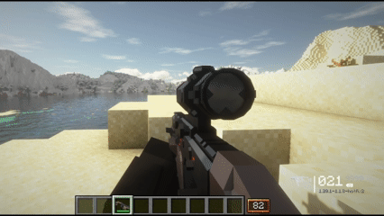</a></td>
</tr>
<tr>
<td align="center"><strong>Distant Horizons</strong> Far terrain at night</td>
<td align="center"><strong>TaCZ Optics</strong> Aiming without ghost rings</td>
</tr>
</table>

***

## What It Adds To Sundial Lite

*   **Ad Astra's sky:** the sun, moon and planets Ad Astra draws are the visible ones, and the shader's light, shadows and light shafts come from that same sun. Water reflects the sun's square shape. Ad Astra's coloured stars keep their colours, and on airless worlds they stay visible by day.
*   **Planet fog** in each biome's own fog colour, from the ground to the horizon, Distant Horizons terrain included.
*   **Exposure modes** (Post processing > Exposure): Steady (the default) follows the time of day, the weather and the world, never where you look, and "Night lift" sets how much it brightens nights and caves; Metered (Sundial's own) follows the brightness on screen; Off keeps one exposure per world. Dark worlds stay dark in every mode.
*   **Thin glass:** glass bends what is behind it only by its surface detail, like a window pane, so the room or street behind it stays in place at shallow angles ("Thin glass", Water and glass).
*   **Glowing ores,** vanilla and modded: only the ore-coloured pixels glow.
*   **Shading where blocks meet:** crease shading on top of screen-space ambient occlusion, and vanilla's block corner shading. Ambient occlusion and ray-traced bounce light each have a switch (Lighting).
*   **Sunshine sheen:** a soft sunlit highlight on ground and grass, plants that glow when lit from behind, and darker shade.
*   **Speed:** clouds and light shafts are computed at half resolution and smoothed over frames, reflections reuse the clouds already on screen, and Umbra skips its shadow pass. Costly settings go much lower than in Sundial, with separate switches for entity, player and block-entity shadows.
*   **Steady reflections:** reflections on rough surfaces (metal, polished stone, wet ground) are averaged over frames, so they don't crawl with grain while you walk, and metals keep their texture in them.
*   **A clear menu:** the main page holds the presets and the screens, each screen shows its common options first and the rest under Advanced, and every option's description starts with what it costs (Low, Medium, Heavy or EXTREME).
*   **Mod fixes:** no ghost rings when aiming TaCZ optics, no mirror glare on held glass, and Distant Horizons blocks glow by their light level.

***

## Outside the modpack

*   The large square sun, the moon and the planets in Earth's sky come from the modpack's Ad Astra sky files, not from the shader. Without them, Earth shows Minecraft's usual sun and moon, and the shader lights the world from those. Keep "ABZA modpack" off there, so water reflects Minecraft's sun at its own size.
*   Interloper, Cinder, Eden, Umbra and their orbits exist only in the modpack. The Moon and the Earth and Moon orbits come with Ad Astra.
*   Dimensions from other mods use the pack's base settings: Sundial's look with ABZA's shared changes. The Nether and the End use Sundial's own.
*   Glowing ores cover the modpack's ore mods; ores from other mods render normally.

***

## Presets

"Profile" on the main shader screen sets the performance options at once, and each preset adds features to the one before. "ABZA modpack", on the same screen, makes water on Earth reflect the modpack's large square sun: the ABZA preset turns it on, and the others leave it as it is. Presets leave exposure, TAA style, motion blur and the look options as you set them.

<table>
<tr><th align="left">Preset</th><th align="left">What it sets</th></tr>
<tr><td><strong>Low</strong></td><td>The clouds and your own shadow, with a 1024-pixel shadow map; no reflections, ambient occlusion, light shafts or fog</td></tr>
<tr><td><strong>Medium</strong></td><td>Low with ambient occlusion, light shafts, fog, underwater caustics and puddles</td></tr>
<tr><td><strong>High</strong> (<strong>default</strong>)</td><td>Medium with reflections, soft, coloured and cloud shadows, depth of field and a 2048-pixel shadow map</td></tr>
<tr><td><strong>Ultra</strong></td><td>High with a 4096-pixel shadow map and mob shadows</td></tr>
<tr><td><strong>ABZA</strong></td><td>High with "ABZA modpack" on</td></tr>
</table>

***

## Known Issues & Other Info

*   Taking a TaCZ gun for the first time can show long dark spikes under the terrain. Reloading shaders (F3+R) fixes it; stock Sundial does it too.
*   Zombie Awareness's blood marks aren't drawn with shaders on.

<table>
<tr><th align="left">Requirement</th><th align="left">Version</th></tr>
<tr><td><strong>Oculus</strong></td><td>1.8.0, with Embeddium</td></tr>
<tr><td><strong>Distant Horizons</strong></td><td><strong>Optional</strong>, tested with 3.3.2</td></tr>
<tr><td><strong><a href="https://www.curseforge.com/minecraft/mc-mods/shaders-companion">Shaders Companion</a></strong></td><td><strong>Optional</strong>, 2.0.0</td></tr>
</table>

***

## With Shaders Companion

The [Shaders Companion](https://www.curseforge.com/minecraft/mc-mods/shaders-companion) mod gives this pack what a shader pack can't see on its own: <strong>real mirrors</strong> in water and glass, up to four at once, reflections of what is behind you, ambient occlusion that doesn't change as you turn, the Auto-PBR Material Engine and more. The mod installs its own copy of this pack with those options and a Max preset; in this download they are off. Its page has the details.

***

## Credit

**Sundial Lite** is made by GeForceLegend and released under the GNU General Public License v3.0 ([GitHub](https://github.com/GeForceLegend/Sundial-Lite), [Modrinth](https://modrinth.com/shader/sundial-lite), [CurseForge](https://www.curseforge.com/minecraft/shaders/sundial-lite)). ABZA Shader is an independent fork, not affiliated with or endorsed by GeForceLegend, released under the same licence. The source is on [GitHub](https://github.com/RinkyDinkyNooble/abza-shader-pack).
